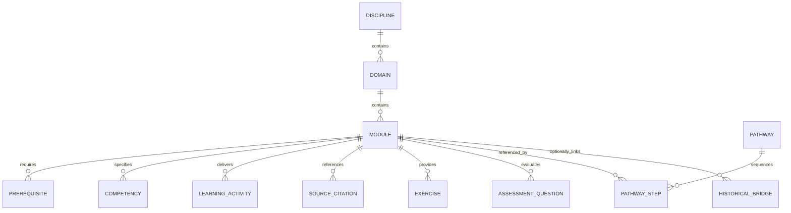

# DATA MODEL SPECIFICATION

> **Scope:** Formal Entity Schemas, Graph Topology Models, Serialization Standards & Database Independence Strategy.

---

## 1. Storage & Serialization Strategy

To guarantee **data independence, portability, and version control integrity**, the Tech Tree utilizes a **File-First Architecture**:
- All canonical data is stored as declarative, human-readable YAML and Markdown files in Git.
- An in-memory graph index is materialized upon boot or rebuild.
- An optional SQLite cache can be maintained for fast full-text search and offline client synchronization, but SQLite is strictly a disposable read replica, never the single source of truth.

---

## 2. Relational Entity Graph (Logical Model)



---

## 3. Core JSON Schema Specifications

### 3.1 Module Schema Definition (`schemas/module.schema.json`)
```json
{
  "$schema": "https://json-schema.org/draft/2020-12/schema",
  "$id": "https://techtree.org/schemas/module.schema.json",
  "title": "TechTreeKnowledgeModule",
  "type": "object",
  "required": [
    "id",
    "slug",
    "title",
    "summary",
    "version",
    "classification",
    "verification",
    "relationships",
    "learning_objectives",
    "provenance"
  ],
  "properties": {
    "id": {
      "type": "string",
      "format": "uuid"
    },
    "slug": {
      "type": "string",
      "pattern": "^[a-z0-9]+(-[a-z0-9]+)*$"
    },
    "title": { "type": "string" },
    "summary": { "type": "string" },
    "version": {
      "type": "string",
      "pattern": "^(0|[1-9]\\d*)\\.(0|[1-9]\\d*)\\.(0|[1-9]\\d*)$"
    },
    "classification": {
      "type": "object",
      "required": ["discipline", "domain", "proficiency_tier", "estimated_duration_minutes"],
      "properties": {
        "discipline": { "type": "string" },
        "domain": { "type": "string" },
        "proficiency_tier": { "type": "integer", "minimum": 1, "maximum": 4 },
        "difficulty_score": { "type": "number", "minimum": 0, "maximum": 1 },
        "estimated_duration_minutes": { "type": "integer", "minimum": 5 }
      }
    },
    "verification": {
      "type": "object",
      "required": ["status"],
      "properties": {
        "status": {
          "type": "string",
          "enum": ["draft", "research-verified", "technically-verified", "expert-reviewed", "published"]
        },
        "reviewed_by": {
          "type": "array",
          "items": { "type": "string" }
        },
        "verification_date": { "type": "string" }
      }
    },
    "relationships": {
      "type": "object",
      "required": ["prerequisites"],
      "properties": {
        "prerequisites": {
          "type": "array",
          "items": {
            "type": "object",
            "required": ["slug", "min_version"],
            "properties": {
              "slug": { "type": "string" },
              "min_version": { "type": "string" },
              "rationale": { "type": "string" }
            }
          }
        },
        "related_modules": {
          "type": "array",
          "items": {
            "type": "object",
            "required": ["slug", "relationship"],
            "properties": {
              "slug": { "type": "string" },
              "relationship": { "type": "string" }
            }
          }
        }
      }
    },
    "learning_objectives": {
      "type": "array",
      "minItems": 1,
      "items": {
        "type": "object",
        "required": ["id", "statement", "bloom_level"],
        "properties": {
          "id": { "type": "string" },
          "statement": { "type": "string" },
          "bloom_level": {
            "type": "string",
            "enum": ["remember", "understand", "apply", "analyze", "evaluate", "create"]
          }
        }
      }
    },
    "provenance": {
      "type": "object",
      "required": ["sources"],
      "properties": {
        "sources": {
          "type": "array",
          "minItems": 1,
          "items": {
            "type": "object",
            "required": ["id", "citation", "claims_supported"],
            "properties": {
              "id": { "type": "string" },
              "citation": { "type": "string" },
              "url": { "type": "string", "format": "uri" },
              "isbn": { "type": "string" },
              "license": { "type": "string" },
              "claims_supported": {
                "type": "array",
                "items": { "type": "string" }
              }
            }
          }
        }
      }
    },
    "discovery_context": {
      "type": "object",
      "properties": {
        "historical_significance": { "type": "string" },
        "historical_influences": {
          "type": "array",
          "items": {
            "type": "object",
            "required": ["discovery_id"],
            "properties": {
              "discovery_id": { "type": "string" },
              "relationship": { "type": "string" }
            }
          }
        }
      }
    }
  }
}
```

---

### 3.2 Pathway Schema Definition (`schemas/pathway.schema.json`)
```json
{
  "$schema": "https://json-schema.org/draft/2020-12/schema",
  "$id": "https://techtree.org/schemas/pathway.schema.json",
  "title": "TechTreeLearningPathway",
  "type": "object",
  "required": ["id", "slug", "title", "description", "target_goal", "capstone_project", "modules"],
  "properties": {
    "id": { "type": "string", "format": "uuid" },
    "slug": { "type": "string" },
    "title": { "type": "string" },
    "description": { "type": "string" },
    "target_goal": { "type": "string" },
    "capstone_project": {
      "type": "object",
      "required": ["title", "description", "deliverable_type"],
      "properties": {
        "title": { "type": "string" },
        "description": { "type": "string" },
        "deliverable_type": { "type": "string" }
      }
    },
    "modules": {
      "type": "array",
      "items": {
        "type": "object",
        "required": ["slug", "sequence_order", "curation_note"],
        "properties": {
          "slug": { "type": "string" },
          "sequence_order": { "type": "integer" },
          "curation_note": { "type": "string" }
        }
      }
    }
  }
}
```
